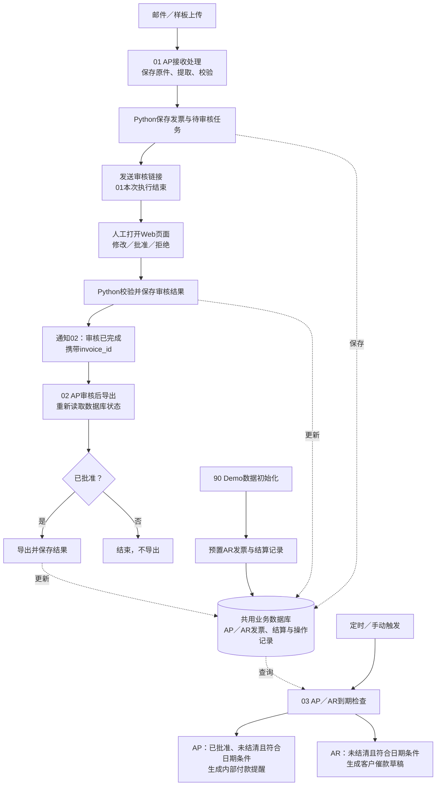

## Final delivery and rollback — 2026-10-07

See [final delivery index](AP_unified_refactor_final_delivery.md) for layered acceptance, two English demo paths, recovery commands and remaining limits. Native → Stage A → original 01/02 → native receiver rollback passed with every business row and all 34 original/export files unchanged. Five isolated file-recovery/migration tests passed. Current native entry is restored; no new model calls. The final fresh paid end-to-end validation gap remains explicit. Earlier records below are historical.

## Native Agent B3–B4 — 2026-10-07 (current runtime)

Native canvas `J4xPbnTCAgYFVNzJ` is published and is now the recommended local demo entry. Upload: http://127.0.0.1:5678/form/ap-native-intake-b2-v2. Both backend event targets point only to its unique review and Excel receivers. Three real native/Python comparisons matched 39 fields within the user-approved 18-request budget. Review, Excel, local notices, replay and restart checks passed. The third native draft required explicit recovery; final commit wiring was verified with closed real drafts, not an additional fresh paid run. Stage A and old 01/02 remain explicit rollback choices. See [B3–B4 evidence and limits](AP_native_agent_B3_B4_log.md) and [demo/rollback instructions](AP_native_agent_demo_operations.md). All earlier runtime claims below are historical.

## Native Agent candidate B2 — 2026-10-07

Unpublished candidate `J4xPbnTCAgYFVNzJ` adds a real n8n Agent with three scoped read-only tools and a bounded Gemini gateway. Backend contracts are deployed and 59 isolated tests passed. Credential binding and live n8n local metadata authentication passed. Full native Agent engine execution and real model quality remain for B3. Stage A remains the live demo, and backend event targets are unchanged. See [B0–B2 implementation](AP_native_agent_B0_B2_log.md).

## Unified canvas A3–A4 — 2026-10-07 (current runtime)

The unified workflow `7xXB2pjXOE1EQ2bY` is published and is the recommended demo canvas. Upload: http://127.0.0.1:5678/form/ap-unified-intake-a2-v1. Review and batch events now target its two unique webhooks. A3 passed with labeled cached analyses, real local notifications, combined Excel, replay and restart checks; 44 targeted tests passed. Original 01/02 remain published and unchanged for rollback; do not run the same email batch through both versions. Native Agent migration remains pending. See [A3–A4 handoff](AP_unified_canvas_A3_A4_log.md). Earlier status sections below are historical.

## Unified canvas A0–A2 — 2026-10-07 (unpublished candidate)

A0 baseline and A1 business mapping are complete. Candidate `7xXB2pjXOE1EQ2bY` combines 01/02 on one canvas with the existing Python Agent: 23 execution nodes, 4 notes, 25 connections and 4 groups. Static validation and instance readback passed; no execution or publication. Original 01/02, backend event targets and business data remain unchanged. Before A3, extend the header privacy hook for both candidate event paths. See [A0–A2 log](AP_unified_canvas_A0_A2_log.md) for mapping, evidence, display warning and next steps. The deployed baseline below remains current.

## Planned unified canvas and native Agent migration — 2026-10-07

The user has approved the direction of combining 01 and 02 into one business-facing canvas while retaining separate event entries and durable backend state. First unify the canvas with the existing Python Agent; then migrate document analysis to a real n8n AI Agent after verifying request controls, evidence, caching and traces. See [implementation plan](AP_unified_canvas_native_agent_implementation_guide_zh.md). This supersedes the earlier requirement to keep 01 and 02 on separate canvases for future implementation. An unpublished candidate has now been created under A0–A2; backend and deployed workflows remain unchanged. Phase03 is deferred.

## Phase02 final integration — 2026-10-07 (current deployed baseline)

The recommended intake is `APApprovalIntakeV9` (`/form/ap-approval-intake-v9`), followed by independent `APReviewExportV1`. Both are imported and published in the local instance; existing v7/v8 and historical workflows remain intact. Approval snapshots enter `/exports` immediately. The user selects a combined Excel download; 02 sends local Mailpit approval/rejection and completed-batch notifications without generating a workbook on every approval.

Schema 5 adds a separate outcome notification ledger. Final acceptance, recovery instructions, evidence and precise mock limitations are in `phase02_final_log.md` and `phase02_final_verification.json`. Earlier sections below are historical snapshots where they conflict with this update.

Current decision (2026-10-07, export-register revision): Approval immediately exposes its immutable snapshot in the database-backed export register. Web /exports filters/previews/selects records and downloads one combined Excel batch with frozen membership. The independent 02 receiver still receives and reloads review events; subsequent integration should notify approval/register availability, not automatically generate one file per approval. Batch-file notifications require a separate batch association and remain planned. Existing single files, v7 and all workflow JSON remain unchanged. See phase02_export_register_log.md and the revised Phase02 guide. Earlier maps below are historical and superseded where they imply automatic per-invoice export.

Current update (2026-10-07): Opt-in APApprovalIntakeV8 adds deterministic automatic approval or pending human review. Web edits/decisions save immutable revisions and pending events; both approval paths share the same decision transaction. Event delivery, workflow02 and Excel generation are not yet connected. v7 remains available. See phase02_review_log.md; the manual-only map below describes the earlier design.

Current update (2026-10-06): Phase01 analysis now uses a real Python LangChain Agent through APAgentIntakeV7. OCR, evidence grounding, amount rules and state changes stay deterministic. v5/v6 files are historical; see phase01_refactor_log.md and phase01_agent_verification.json for runtime evidence and quality limits.

Current implementation update (2026-10-06): Phase 01 steps 6–8 are verified. Upload v4 and manual readonly Gmail intake share the backend, attachment child and persistent Mailpit notification status. Five real external test emails, local representative/100-message cached batches, replay and container persistence passed. Review remains pending/read-only. See log_2026-10-06_step06_08_acceptance.md; older unimplemented statements below are historical.

先纠正一个数量上的歧义：**AR 的提醒分支已经包含在第三条工作流里，不是再加一条完整 AR 流程。** 额外的 AR 初始化只是把模拟发票放进数据库。

可以把项目想象成这样的目录：

```text
发票自动化 Demo
│
├─ 01_AP接收处理                 ← 现在开始搭建
│    接收附件 → 提取 → 校验 → 创建审核任务
│
├─ 02_AP审核后导出               ← 先预留
│    接收审核完成事件 → 确认状态 → 导出
│
├─ 03_AP_AR到期检查              ← 先预留
│    ├─ AP：内部付款提醒
│    └─ AR：客户催款草稿
│
├─ 90_Demo数据初始化             ← 辅助流程
│    导入已开具的 AR 发票及模拟结算记录
│
└─ 99_共用技术故障通知            ← 辅助流程
     记录失败执行 → 通知
```

**这只是组织和命名方式，不要求现在创建目录或把每段都实现。**

它们实际的衔接关系如下：



这里有**两种不同的连接**，理解这一点就容易了：

- **事件连接：① → 人工审核 → ②。** 第一条创建审核任务并通知人；人完成审核后，Python 发出事件启动第二条。不是第一条直接执行第二条。
- **数据连接：①／②／AR 初始化 → 数据库 → ③。** 第三条定时读取符合条件的记录，不需要第一条或第二条主动调用它。

因此，**AP 发票不是必须“导出后才能进入第三条”**。按照目前的建议规则，只要已经批准、还有未结清金额，并符合日期条件，就可以被付款提醒查询选中；是否要求“已导出”也满足，再作为业务规则决定。

**你现在写第一条时，终点可以非常明确：**

> 发票已经存储，提取和校验结果已经保存，创建了待审核任务，审核人收到了指向该发票的链接。

第一条交给后续的最小信息是：

- `invoice_id`：后续各处识别同一张发票；
- `direction = AP`：业务方向；
- `review_status = pending`：当前等待人工审核；
- `review_url`：审核入口。

这些是拟议字段名。原件、提取结果、异常信息保存在后端，通过 `invoice_id` 获取，不必一路复制到后面所有工作流。

**为了让你现在就“看见后面的空位”，可以先在 n8n 中建三个命名清楚的画布：**

- **01**：搭实际节点，末尾写清楚“创建审核任务并通知，等待外部审核事件”。
- **02**：先放 Webhook 入口和说明节点，注明接收 `invoice_id`，然后查询审核状态、导出。
- **03**：先放定时入口和 AP／AR 两个示例分支，注明从共用数据库筛选记录。
