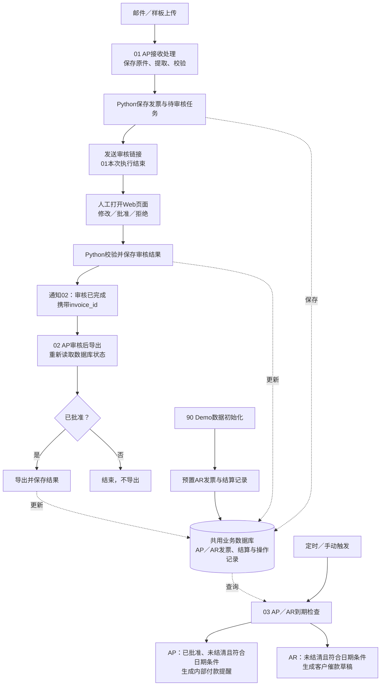

先纠正一个数量上的歧义：**AR 的提醒分支已经包含在第三条工作流里，不是再加一条完整 AR 流程。** 额外的 AR 初始化只是把模拟发票放进数据库。

可以把项目想象成这样的目录：

```text
发票自动化 Demo
│
├─ 01_AP接收处理                 ← 现在开始搭建
│    接收附件 → 提取 → 校验 → 创建审核任务
│
├─ 02_AP审核后导出               ← 先预留
│    接收审核完成事件 → 确认状态 → 导出
│
├─ 03_AP_AR到期检查              ← 先预留
│    ├─ AP：内部付款提醒
│    └─ AR：客户催款草稿
│
├─ 90_Demo数据初始化             ← 辅助流程
│    导入已开具的 AR 发票及模拟结算记录
│
└─ 99_共用技术故障通知            ← 辅助流程
     记录失败执行 → 通知
```

**这只是组织和命名方式，不要求现在创建目录或把每段都实现。**

它们实际的衔接关系如下：



这里有**两种不同的连接**，理解这一点就容易了：

- **事件连接：① → 人工审核 → ②。** 第一条创建审核任务并通知人；人完成审核后，Python 发出事件启动第二条。不是第一条直接执行第二条。
- **数据连接：①／②／AR 初始化 → 数据库 → ③。** 第三条定时读取符合条件的记录，不需要第一条或第二条主动调用它。

因此，**AP 发票不是必须“导出后才能进入第三条”**。按照目前的建议规则，只要已经批准、还有未结清金额，并符合日期条件，就可以被付款提醒查询选中；是否要求“已导出”也满足，再作为业务规则决定。

**你现在写第一条时，终点可以非常明确：**

> 发票已经存储，提取和校验结果已经保存，创建了待审核任务，审核人收到了指向该发票的链接。

第一条交给后续的最小信息是：

- `invoice_id`：后续各处识别同一张发票；
- `direction = AP`：业务方向；
- `review_status = pending`：当前等待人工审核；
- `review_url`：审核入口。

这些是拟议字段名。原件、提取结果、异常信息保存在后端，通过 `invoice_id` 获取，不必一路复制到后面所有工作流。

**为了让你现在就“看见后面的空位”，可以先在 n8n 中建三个命名清楚的画布：**

- **01**：搭实际节点，末尾写清楚“创建审核任务并通知，等待外部审核事件”。
- **02**：先放 Webhook 入口和说明节点，注明接收 `invoice_id`，然后查询审核状态、导出。
- **03**：先放定时入口和 AP／AR 两个示例分支，注明从共用数据库筛选记录。